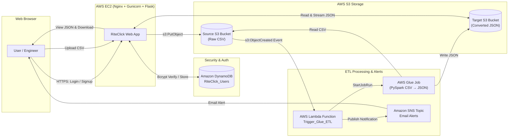

# RiteClick Cloud ETL Platform

A secure, automated, serverless ETL web application built with **Python Flask**, hosted on **AWS EC2**, with **DynamoDB** authentication, **S3** data lakes, **AWS Lambda** event triggering, **AWS Glue** (PySpark CSV &rarr; JSON conversion), and **Amazon SNS** email alerting.

---

## 🏗️ Architecture Overview



---

## 📋 Table of Contents
1. [Details You Need to Provide / Configure](#1-details-you-need-to-provide--configure)
2. [Project Structure](#2-project-structure)
3. [Step-by-Step AWS Setup Guide](#3-step-by-step-aws-setup-guide)
   - [Step 3.1: DynamoDB Users Table](#step-31-dynamodb-users-table)
   - [Step 3.2: S3 Source & Target Buckets](#step-32-s3-source--target-buckets)
   - [Step 3.3: Amazon SNS Topic & Email Alerts](#step-33-amazon-sns-topic--email-alerts)
   - [Step 3.4: IAM Roles & Policies (Least Privilege)](#step-34-iam-roles--policies-least-privilege)
   - [Step 3.5: AWS Glue PySpark Job](#step-35-aws-glue-pyspark-job)
   - [Step 3.6: AWS Lambda Function & S3 Event Trigger](#step-36-aws-lambda-function--s3-event-trigger)
   - [Step 3.7: EC2 Instance Deployment (Nginx, Gunicorn, HTTPS)](#step-37-ec2-instance-deployment-nginx-gunicorn-https)
4. [Local Testing & Verification](#4-local-testing--verification)

---

## 1. Details You Need to Provide / Configure

Before deploying, choose names for your AWS resources and update your `.env` configuration file:

| Setting / Detail | Recommended Name / Value | Description |
| :--- | :--- | :--- |
| **AWS Region** | `us-east-1` (or your preferred region) | The region where all services will reside. |
| **Source S3 Bucket** | `riteclick-source-<your-aws-account-id>` | Bucket where users upload CSV files. (Globally unique name). |
| **Target S3 Bucket** | `riteclick-target-<your-aws-account-id>` | Bucket where Glue outputs converted JSON datasets. |
| **DynamoDB Table** | `RiteClick_Users` | Table storing user credentials and authentication data. |
| **AWS Glue Job** | `riteclick-csv-to-json-job` | PySpark Glue Job name. |
| **SNS Topic** | `riteclick-etl-notifications` | SNS Topic distributing email notifications. |
| **Alert Email Address** | `your-email@example.com` | Email address that subscribes to SNS to receive job start alerts. |
| **EC2 Domain / IP** | Elastic IP or DNS Domain | Used for web access and SSL certificate binding. |

---

## 2. Project Structure

```text
ETL/
├── app/
│   ├── static/
│   │   ├── css/style.css         # Modern dark SaaS design system (Glassmorphism, responsive)
│   │   └── js/main.js            # Drag & drop upload, copy-to-clipboard, table search, tab toggle
│   ├── templates/
│   │   ├── base.html             # Master layout with navbar, alerts, footer
│   │   ├── index.html            # Landing page with interactive architecture visualizer
│   │   ├── signup.html           # User registration (DynamoDB + bcrypt)
│   │   ├── login.html            # User authentication
│   │   ├── dashboard.html        # Main dashboard with metrics and Glue status
│   │   ├── upload.html           # CSV drag-and-drop upload console
│   │   ├── processed.html        # Converted JSON files browser & filter
│   │   ├── view_json.html        # Interactive JSON tree & raw code viewer with download
│   │   ├── 404.html              # Custom 404 handler
│   │   ├── 413.html              # Payload too large handler
│   │   └── 500.html              # Server error handler
│   ├── __init__.py               # Flask application factory
│   ├── auth.py                   # Bcrypt password hashing & @login_required decorator
│   ├── aws_services.py           # Boto3 DynamoDB, S3, and Glue integrations
│   ├── config.py                 # Application configuration & security headers
│   └── routes.py                 # Route definitions & business logic
├── lambda/
│   └── lambda_function.py        # S3 ObjectCreated handler: starts Glue job & publishes SNS
├── glue/
│   └── csv_to_json_job.py        # PySpark ETL script converting CSV -> JSON
├── scripts/
│   ├── setup_dynamodb.py         # Automated provisioning for DynamoDB table + GSI
│   ├── setup_s3_buckets.py       # Automated S3 creation with SSE-S3 AES256 & block public access
│   └── setup_sns.py              # Automated SNS topic creation & email subscriber
├── deployment/
│   ├── iam_policies/
│   │   ├── ec2_policy.json       # Least-privilege IAM policy for EC2 instance profile
│   │   ├── lambda_policy.json    # Least-privilege IAM policy for Lambda execution role
│   │   └── glue_policy.json      # Least-privilege IAM policy for AWS Glue job
│   ├── nginx.conf                # Nginx reverse proxy with SSL/TLS ciphers & 100MB body limit
│   ├── riteclick.service         # Systemd service daemon for Gunicorn
│   └── setup_ec2.sh              # 1-click EC2 automated setup script
├── sample_data/
│   └── customers_sample.csv      # Sample CSV for testing end-to-end conversion
├── .env.example                  # Environment variable template
├── requirements.txt              # Python dependencies
├── run.py                        # Application entry point
└── README.md
```

---

## 3. Step-by-Step AWS Setup Guide

### Step 3.1: DynamoDB Users Table
1. You can run the included Python setup script:
   ```bash
   python scripts/setup_dynamodb.py
   ```
2. **Or configure via AWS Console**:
   - Go to **Amazon DynamoDB** &rarr; **Tables** &rarr; **Create table**.
   - Table name: `RiteClick_Users`
   - Partition key: `email` (Type: `String`)
   - Table class: DynamoDB Standard
   - Read/write capacity: **On-demand** (`PAY_PER_REQUEST`).
   - Create a **Global Secondary Index (GSI)**:
     - Index name: `UsernameIndex`
     - Partition key: `username` (Type: `String`)
     - Projected attributes: `All`

---

### Step 3.2: S3 Source & Target Buckets
1. Run the included setup script:
   ```bash
   python scripts/setup_s3_buckets.py
   ```
2. **Or configure via AWS Console**:
   - **Source Bucket**: e.g., `riteclick-etl-source-data-<account_id>`
   - **Target Bucket**: e.g., `riteclick-etl-processed-data-<account_id>`
   - On both buckets:
     - Enable **Block all public access** (Checked).
     - Enable **Default encryption**: Amazon S3 managed key (SSE-S3).

---

### Step 3.3: Amazon SNS Topic & Email Alerts
1. Run the script with your email:
   ```bash
   python scripts/setup_sns.py your-email@domain.com
   ```
2. **Or configure via AWS Console**:
   - Go to **Amazon SNS** &rarr; **Topics** &rarr; **Create topic**.
   - Type: **Standard**.
   - Name: `riteclick-etl-notifications`
   - Click **Create topic**. Copy the generated `Topic ARN`.
   - Click **Create subscription**:
     - Protocol: `Email`
     - Endpoint: `your-email@domain.com`
   - **Important**: Check your inbox and click **"Confirm subscription"** in the AWS confirmation email.

---

### Step 3.4: IAM Roles & Policies (Least Privilege)

Create three IAM roles in the **IAM Console** using the policies located in `deployment/iam_policies/`:

#### Role 1: `RiteClick_EC2_Role`
- **Trusted Entity**: AWS Service &rarr; `EC2`
- **Permissions**: Attach inline policy from `deployment/iam_policies/ec2_policy.json` (substitute your exact bucket names).
- Attach this role to your EC2 instance via **EC2 Console** &rarr; **Actions** &rarr; **Security** &rarr; **Modify IAM role**.

#### Role 2: `RiteClick_Lambda_Role`
- **Trusted Entity**: AWS Service &rarr; `Lambda`
- **Permissions**: Attach inline policy from `deployment/iam_policies/lambda_policy.json`.

#### Role 3: `RiteClick_Glue_Role`
- **Trusted Entity**: AWS Service &rarr; `Glue`
- **Permissions**: Attach inline policy from `deployment/iam_policies/glue_policy.json` and AWS managed policy `AWSGlueServiceRole`.

---

### Step 3.5: AWS Glue PySpark Job
1. Upload the script `glue/csv_to_json_job.py` to an S3 location (e.g. `s3://<source-bucket>/scripts/csv_to_json_job.py`).
2. Go to **AWS Glue Console** &rarr; **ETL jobs** &rarr; **Script editor**:
   - Engine: **Spark** (Python 3)
   - Job details:
     - Name: `riteclick-csv-to-json-job`
     - IAM Role: `RiteClick_Glue_Role`
     - Glue version: `Glue 4.0` (Apache Spark 3.3, Python 3)
     - Script filename: Select your uploaded `csv_to_json_job.py`
     - Worker type: `G.1X`
     - Requested number of workers: `2` (minimum for testing to keep costs minimal)
   - Click **Save**.

---

### Step 3.6: AWS Lambda Function & S3 Event Trigger
1. Go to **AWS Lambda Console** &rarr; **Create function**:
   - Function name: `RiteClick_Trigger_Glue_ETL`
   - Runtime: **Python 3.11** or **Python 3.12**
   - Execution role: Use existing role &rarr; `RiteClick_Lambda_Role`
2. Paste the code from `lambda/lambda_function.py` into the code editor.
3. Configure **Environment Variables** in Lambda (**Configuration** &rarr; **Environment variables**):
   - `GLUE_JOB_NAME`: `riteclick-csv-to-json-job`
   - `TARGET_S3_BUCKET`: `riteclick-etl-processed-data` (your target bucket)
   - `SNS_TOPIC_ARN`: `arn:aws:sns:us-east-1:123456789012:riteclick-etl-notifications`
4. Deploy the function.
5. Add the **S3 Event Trigger**:
   - Click **Add trigger** &rarr; Select **S3**.
   - Bucket: Select your **Source S3 Bucket**.
   - Event types: `All object create events` (`s3:ObjectCreated:*`).
   - Suffix: `.csv`
   - Acknowledge recursive invocation warning and click **Add**.

---

### Step 3.7: EC2 Instance Deployment (Nginx, Gunicorn, HTTPS)

1. **Launch EC2 Instance**:
   - AMI: **Amazon Linux 2023** (or Ubuntu 22.04 LTS).
   - Instance Type: `t3.small` or `t3.micro`.
   - Security Group: Allow inbound:
     - Port 22 (SSH) from your IP.
     - Port 80 (HTTP) from `0.0.0.0/0`.
     - Port 443 (HTTPS) from `0.0.0.0/0`.
   - Attach IAM Role: `RiteClick_EC2_Role`.

2. **Connect & Deploy**:
   SSH into your EC2 instance and run:
   ```bash
   # Clone or copy project files to EC2
   git clone <YOUR_REPO_URL> riteclick-app
   cd riteclick-app

   # Make deployment script executable and run it
   chmod +x deployment/setup_ec2.sh
   ./deployment/setup_ec2.sh
   ```

3. **HTTPS Certificate with Let's Encrypt (Optional for production domains)**:
   If you have a domain name pointing to your EC2 public IP:
   ```bash
   sudo dnf install -y certbot python3-certbot-nginx
   sudo certbot --nginx -d yourdomain.com
   ```

---

## 4. Local Testing & Verification

You can test the Flask web application locally before deploying to EC2:

1. Create a Python virtual environment:
   ```bash
   python -m venv venv
   # Windows:
   venv\Scripts\activate
   # Linux/macOS:
   source venv/bin/activate
   ```
2. Install dependencies:
   ```bash
   pip install -r requirements.txt
   ```
3. Copy `.env.example` to `.env` and fill in your AWS credentials or ensure your local AWS CLI is configured via `aws configure`.
4. Run the development server:
   ```bash
   python run.py
   ```
5. Open `http://localhost:5000`:
   - Click **Get Started** &rarr; Sign up with username and email.
   - Go to **Upload CSV** &rarr; Drag and drop `sample_data/customers_sample.csv`.
   - Click **Ingest & Process File**.
   - Check your email for the **SNS notification** from AWS.
   - Navigate to **Processed Files** to inspect and download the converted JSON output!
