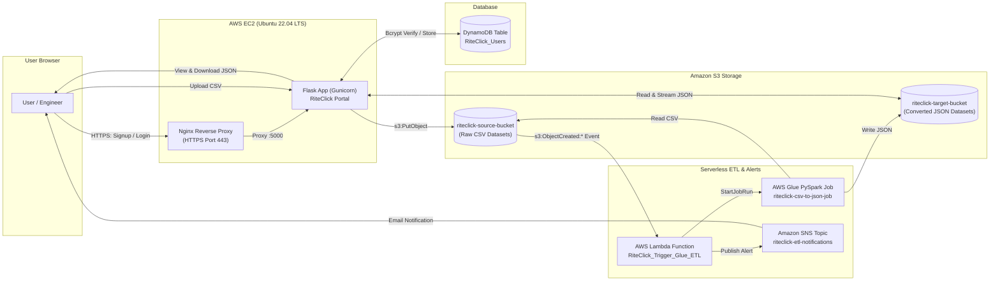

# 🚀 RiteClick Automated Cloud ETL - Complete Deployment Guide

> **Official Blueprint & Step-by-Step Tutorial Guide**  
> *Engineered for AWS EC2, Flask, DynamoDB, S3, AWS Lambda, AWS Glue (PySpark), and Amazon SNS.*

---

## 🏗️ Architecture Workflow



---

## 📋 AWS Resource Cheatsheet (Exact Names Used)

| AWS Resource | Exact Name Used | Key Configurations |
| :--- | :--- | :--- |
| **AWS Region** | `us-east-1` (N. Virginia) | Must be identical across all services |
| **Source S3 Bucket** | `riteclick-source-bucket` | Block Public Access: ON, Encryption: SSE-S3 |
| **Target S3 Bucket** | `riteclick-target-bucket` | Block Public Access: ON, Encryption: SSE-S3 |
| **DynamoDB Table** | `RiteClick_Users` | **Partition Key (HASH)**: `email` (String)<br>**Sort Key (RANGE)**: `username` (String)<br>Capacity: **On-demand** |
| **SNS Topic** | `riteclick-etl-notifications` | Type: Standard<br>Subscription: `Email` &rarr; `your-email@gmail.com` |
| **AWS Glue Job** | `riteclick-csv-to-json-job` | Type: **Spark** (Glue 4.0, Python 3)<br>Workers: 2 (G.1X), Timeout: 10 mins<br>Script: `s3://aws-glue-assets-<ACCOUNT_ID>-us-east-1/scripts/riteclick-csv-to-json-job.py` |
| **AWS Lambda** | `RiteClick_Trigger_Glue_ETL` | Runtime: **Python 3.12**<br>Timeout: **1 min 0 sec**<br>Trigger: S3 `riteclick-source-bucket` (`.csv`) |
| **EC2 Instance** | `RiteClick-Web-Server` | AMI: **Ubuntu Server 22.04 LTS** (t3.small or t3.micro)<br>Security Group: Ports **22, 80, 443** open |

---

## 🔐 IAM Roles & Attached Policies

### Role 1: `RiteClick_EC2_Role`
- **Trusted Entity**: AWS Service &rarr; **`EC2`**
- **Attached Policies (AWS Managed)**:
  - `AmazonDynamoDBFullAccess` *(Reads/writes users during signup & login)*
  - `AmazonS3FullAccess` *(Uploads CSVs to source bucket & fetches JSON from target bucket)*
  - `AWSGlueConsoleFullAccess` *(Allows web dashboard to display Glue job status)*

---

### Role 2: `RiteClick_Lambda_Role`
- **Trusted Entity**: AWS Service &rarr; **`Lambda`**
- **Attached Policies (AWS Managed)**:
  - `AWSLambdaBasicExecutionRole` *(CloudWatch log streams)*
  - `AmazonS3ReadOnlyAccess` *(Inspects S3 upload events)*
  - `AWSGlueConsoleFullAccess` *(Invokes `glue:StartJobRun`)*
  - `AmazonSNSFullAccess` *(Publishes alert emails via SNS)*

---

### Role 3: `RiteClick_Glue_Role`
- **Trusted Entity**: AWS Service &rarr; **`Glue`**
- **Attached Policies (AWS Managed)**:
  - `AWSGlueServiceRole` *(Spark execution engine)*
  - `AmazonS3FullAccess` *(Reads source CSV and writes target JSON)*
- **⚠️ Crucial Trust Policy**: The Trust Relationship MUST specify `glue.amazonaws.com`:
  ```json
  {
    "Version": "2012-10-17",
    "Statement": [
      {
        "Effect": "Allow",
        "Principal": {
          "Service": "glue.amazonaws.com"
        },
        "Action": "sts:AssumeRole"
      }
    ]
  }
  ```

---

## 🎬 Step-by-Step Creation Sequence

Follow this exact order when recording or recreating the project:

### Step 1: Create IAM Roles First
Create the 3 roles listed above (`RiteClick_EC2_Role`, `RiteClick_Lambda_Role`, `RiteClick_Glue_Role`) so they are ready to be attached to services in subsequent steps.

---

### Step 2: Create S3 Storage Buckets
1. Go to **Amazon S3 &rarr; Create bucket**:
   - Bucket 1: `riteclick-source-bucket`
   - Bucket 2: `riteclick-target-bucket`
2. Keep all default security settings (Block All Public Access: **Enabled**, Server-side encryption: **Amazon S3-managed keys SSE-S3**).

---

### Step 3: Create DynamoDB Users Table
1. Go to **DynamoDB &rarr; Tables &rarr; Create table**:
   - **Table name**: `RiteClick_Users`
   - **Partition key**: `email` (String)
   - **Sort key**: `username` (String)
   - **Table settings**: Customize settings &rarr; Capacity mode: **On-demand**.
2. Click **Create table**.

---

### Step 4: Create Amazon SNS Topic & Email Alerts
1. Go to **Amazon SNS &rarr; Topics &rarr; Create topic**:
   - Type: **Standard**
   - Name: `riteclick-etl-notifications`
   - Click **Create topic**. Copy the generated **Topic ARN**.
2. Under **Subscriptions** &rarr; click **Create subscription**:
   - Protocol: **Email**
   - Endpoint: `your-email@gmail.com`
   - Click **Create subscription**.
3. ⚠️ **Critical Action**: Open Gmail &rarr; Find email with subject `AWS Notification - Subscription Confirmation` &rarr; Click **Confirm subscription**. *(Status must change to `Confirmed`)*.

---

### Step 5: Create AWS Glue PySpark Job
1. Go to **AWS Glue Console &rarr; ETL jobs &rarr; Script editor**:
   - Select **Spark** &rarr; **Start fresh** &rarr; **Create script**.
2. In the **Script** tab, paste the contents of `glue/csv_to_json_job.py`.
3. In the **Job details** tab:
   - **Name**: `riteclick-csv-to-json-job`
   - **IAM Role**: `RiteClick_Glue_Role`
   - **Type**: `Spark`
   - **Glue version**: `Glue 4.0`
   - **Language**: `Python 3`
   - **Worker type**: `G.1X`
   - **Requested number of workers**: `2`
   - **Job timeout**: `10 minutes`
4. Click **Save**.
5. ⚠️ **Note on Script Storage**: If Glue gives a 404 on the script, upload `csv_to_json_job.py` to:  
   `s3://aws-glue-assets-<YOUR_ACCOUNT_ID>-us-east-1/scripts/riteclick-csv-to-json-job.py`.

---

### Step 6: Create AWS Lambda Function & S3 Trigger
1. Go to **AWS Lambda &rarr; Create function**:
   - Select **Author from scratch**
   - **Function name**: `RiteClick_Trigger_Glue_ETL`
   - **Runtime**: `Python 3.12`
   - **Execution role**: Use an existing role &rarr; `RiteClick_Lambda_Role`.
2. Paste the code from `lambda/lambda_function.py` and click **Deploy**.
3. Under **Configuration &rarr; Environment variables &rarr; Edit**:
   - `GLUE_JOB_NAME`: `riteclick-csv-to-json-job`
   - `TARGET_S3_BUCKET`: `riteclick-target-bucket`
   - `SNS_TOPIC_ARN`: `arn:aws:sns:us-east-1:<YOUR_ACCOUNT_ID>:riteclick-etl-notifications`
4. Under **Configuration &rarr; General configuration &rarr; Edit**:
   - Change **Timeout** to **`1 min 0 sec`**.
5. Add the **S3 Trigger**:
   - Click **Add trigger** &rarr; Select **S3**.
   - Bucket: `riteclick-source-bucket`
   - Event type: `All object create events` (`s3:ObjectCreated:*`)
   - Suffix: `.csv`
   - Acknowledge recursive invocation checkbox &rarr; Click **Add**.

---

### Step 7: Launch EC2 Instance & Attach IAM Role
1. Launch an EC2 Instance:
   - Name: `RiteClick-Web-Server`
   - AMI: **Ubuntu Server 22.04 LTS**
   - Instance type: `t3.small` (or `t3.micro`)
   - Key pair: Select your `.pem` / `.ppk` key.
   - Network / Security Group: Allow **SSH (22)**, **HTTP (80)**, and **HTTPS (443)** from anywhere (`0.0.0.0/0`).
2. Attach the IAM Role:
   - In EC2 Console &rarr; Select instance &rarr; **Actions &rarr; Security &rarr; Modify IAM role**.
   - Select **`RiteClick_EC2_Role`** &rarr; Click **Update IAM role**.

---

## 💻 EC2 Setup: File Transfer & Terminal Commands

### 1. WinSCP File Transfer
Connect via WinSCP to your EC2 instance (`Host: <EC2_PUBLIC_IP>`, `User: ubuntu`).

**In `/home/ubuntu`, drag and drop ONLY these files:**
- 📁 `app/`
- 📁 `deployment/`
- 📁 `scripts/`
- 📁 `sample_data/`
- 📄 `requirements.txt`
- 📄 `run.py`
- 📄 `.env`
- 📄 `README.md`

*(❌ DO NOT copy `venv/`, `__pycache__/`, or `data_local/`)*.

---

### 2. PuTTY All-in-One Setup Script
Connect via PuTTY and paste these commands sequentially:

```bash
# 1. Update OS and install prerequisites
sudo apt-get update -y
sudo apt-get install -y python3 python3-pip python3-venv git nginx openssl

# 2. Set up Python Virtual Environment & Install Requirements
cd /home/ubuntu
python3 -m venv venv
source venv/bin/activate
pip install --upgrade pip
pip install -r requirements.txt

# 3. Generate Self-Signed SSL Certificate for HTTPS
sudo mkdir -p /etc/ssl/certs /etc/ssl/private
sudo openssl req -x509 -nodes -days 365 -newkey rsa:2048 \
    -keyout /etc/ssl/private/riteclick.key \
    -out /etc/ssl/certs/riteclick.crt \
    -subj "/C=US/ST=Cloud/L=Seattle/O=RiteClick/OU=DataPlatform/CN=localhost"

# 4. Fix Ubuntu home directory permissions so Nginx can load CSS/JS
sudo chmod 755 /home/ubuntu
sudo chmod -R 755 /home/ubuntu/app/static

# 5. Configure Nginx Reverse Proxy
sudo cp deployment/nginx.conf /etc/nginx/sites-available/riteclick
sudo sed -i 's|alias .*/static/|alias /home/ubuntu/app/static/|g' /etc/nginx/sites-available/riteclick
sudo ln -sf /etc/nginx/sites-available/riteclick /etc/nginx/sites-enabled/
sudo rm -f /etc/nginx/sites-enabled/default

sudo nginx -t
sudo systemctl enable nginx
sudo systemctl restart nginx

# 6. Configure Systemd Service for Gunicorn Daemon
sudo tee /etc/systemd/system/riteclick.service > /dev/null << 'EOF'
[Unit]
Description=RiteClick Cloud ETL Gunicorn Service
After=network.target

[Service]
User=ubuntu
Group=ubuntu
WorkingDirectory=/home/ubuntu
Environment="PATH=/home/ubuntu/venv/bin"
EnvironmentFile=/home/ubuntu/.env
ExecStart=/home/ubuntu/venv/bin/gunicorn --workers 3 --bind 127.0.0.1:5000 --timeout 120 run:app
Restart=always
RestartSec=5

[Install]
WantedBy=multi-user.target
EOF

# 7. Start and enable the RiteClick service
sudo systemctl daemon-reload
sudo systemctl enable riteclick
sudo systemctl restart riteclick

# 8. Check status (Press 'q' to exit status view)
sudo systemctl status riteclick
```

---


